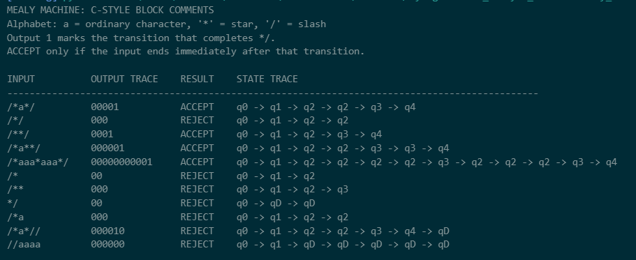
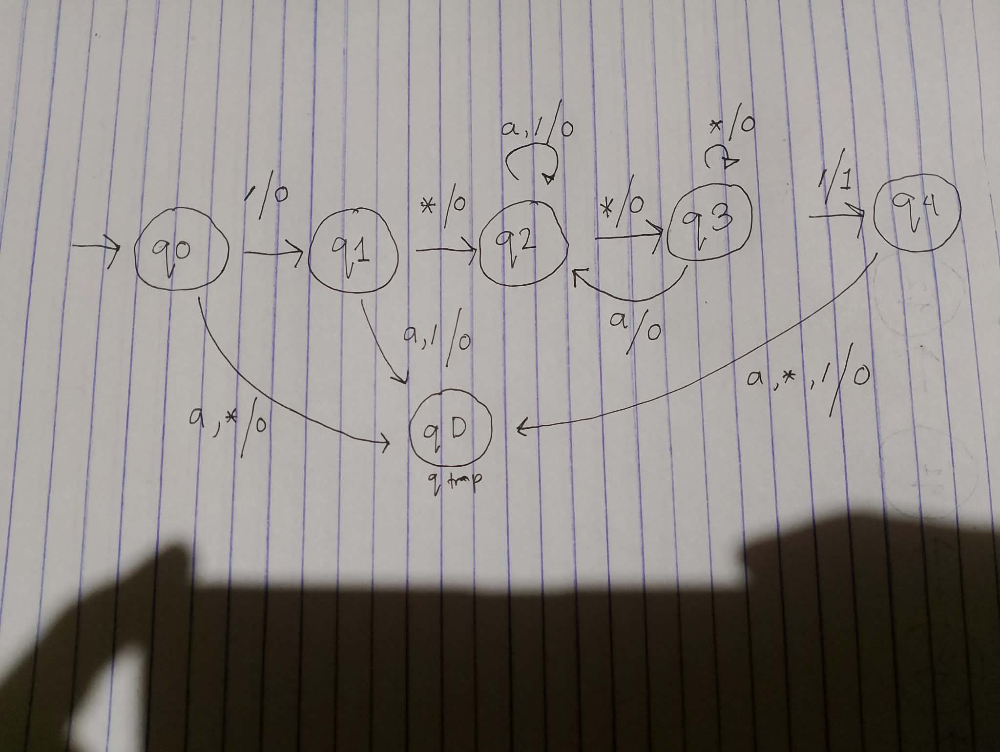

# Tayong-GM-CS13_C-style_comment-Mealy_Machine_Assignment

# Mealy Machine for C-Style Comments

A Python implementation of a **Mealy Machine** that recognizes C-style block comments (`/* ... */`). This project demonstrates state transitions, output generation, and string validation using a finite-state machine.

## Project Overview

The machine recognizes valid C-style block comments using the following simplified input alphabet:

- `a` — Any character other than `*` or `/`
- `*` — Asterisk
- `/` — Slash

A valid comment must start with `/*` and end with `*/`.

## State Diagram


Each transition is labeled using the format `input / output`.

- `0` — The closing delimiter has not just been completed.
- `1` — The closing delimiter `*/` has just been completed.

The input is accepted only if it ends immediately after the machine outputs `1`.

## States and Their Functions

| State | Description |
|---|---|
| `q0` | Initial state; waiting for `/` |
| `q1` | The first `/` has been read; waiting for `*` |
| `q2` | Inside the comment; the previous character is not `*` |
| `q3` | Inside the comment; the previous character is `*` |
| `q4` | Accepting state; the comment has been properly closed |
| `qD` | Dead state; the input cannot be accepted |


The program will display test results in the terminal and generate the state diagram image.

## Sample Test Cases

| Input | Expected Output | Explanation |
|---|---|---|
| `/*a*/` | ACCEPT | Valid block comment |
| `/**/` | ACCEPT | Empty comment body |
| `/*a**/` | ACCEPT | Valid comment with an extra asterisk |
| `/*aaa*aaa*/` | ACCEPT | Valid comment containing ordinary characters |
| `/*` | REJECT | Missing closing delimiter |
| `/**` | REJECT | Missing closing slash |
| `*/` | REJECT | Invalid opening delimiter |
| `/*a` | REJECT | Comment is not closed |
| `/*a*//` | REJECT | Extra character after the comment |
| `//aaaa` | REJECT | Does not start with `/*` |

## How It Works

1. The machine starts at `q0`.
2. It reads `/` and transitions to `q1`.
3. It reads `*` and transitions to `q2`, entering the comment body.
4. The machine processes the characters inside the comment using `q2` and `q3`.
5. When it reads `/` immediately after an asterisk, it completes the closing delimiter `*/`, outputs `1`, and transitions to `q4`.
6. If the input ends in `q4`, the comment is accepted. If additional characters follow, the machine rejects the input.

## Project Structure

```text
.
├── README.md
├── mealy_c_style_comments.py
└── mealy_c_style_comments_graph.png
```
## Program Output



## Graph

